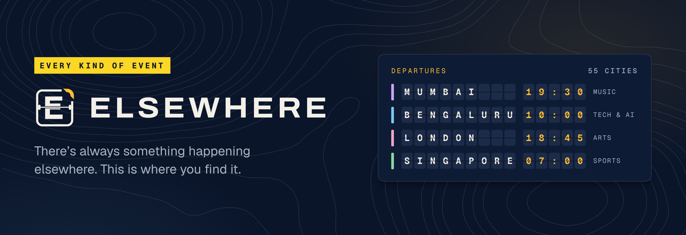
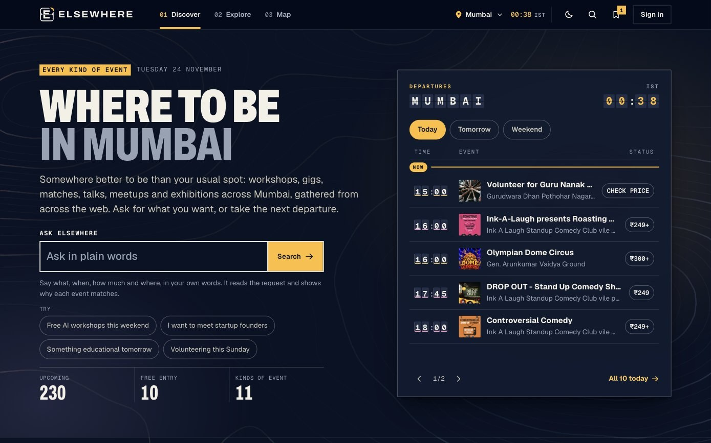
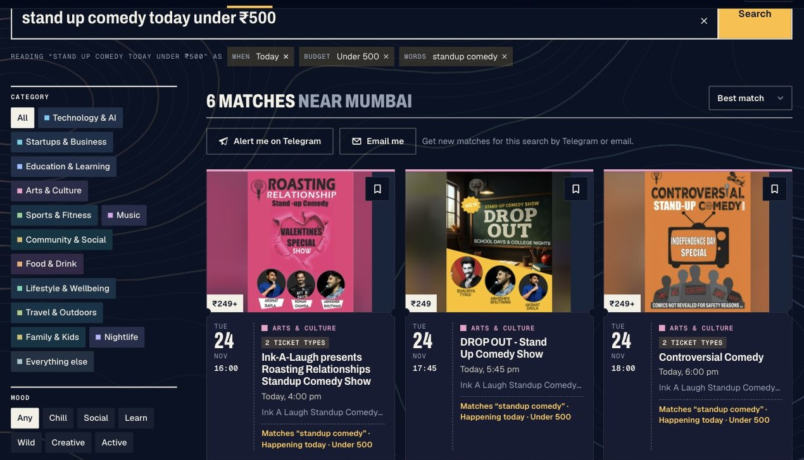
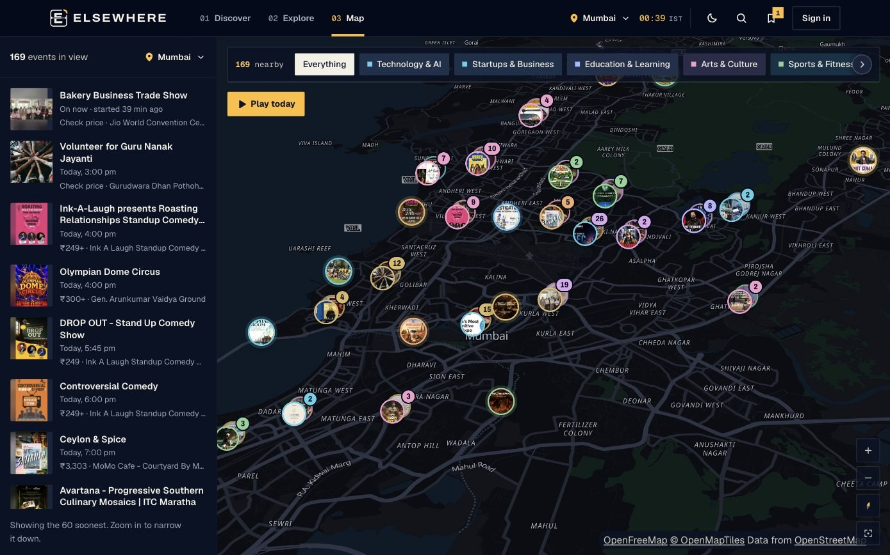
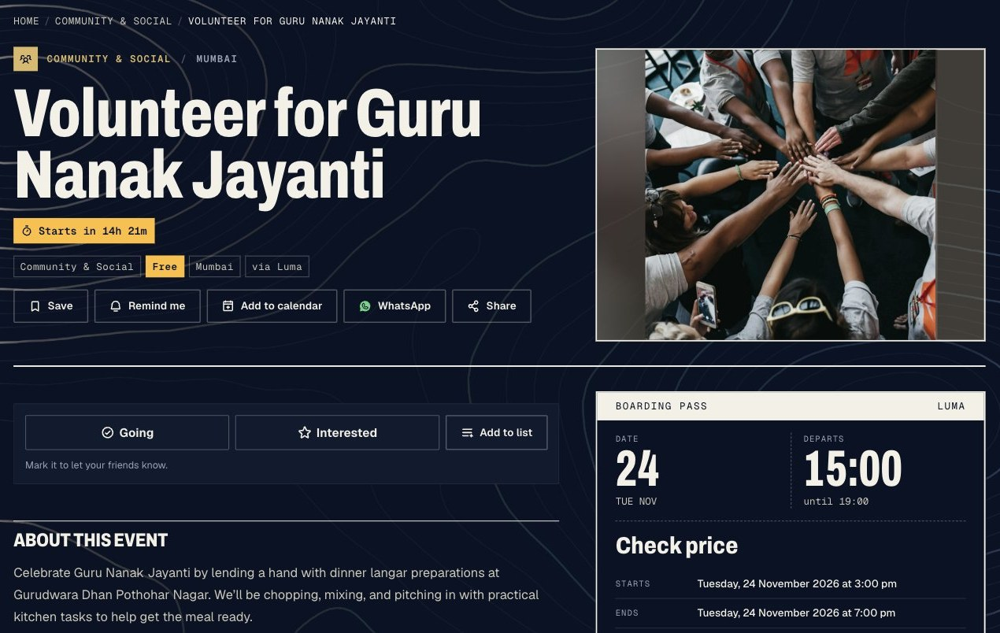
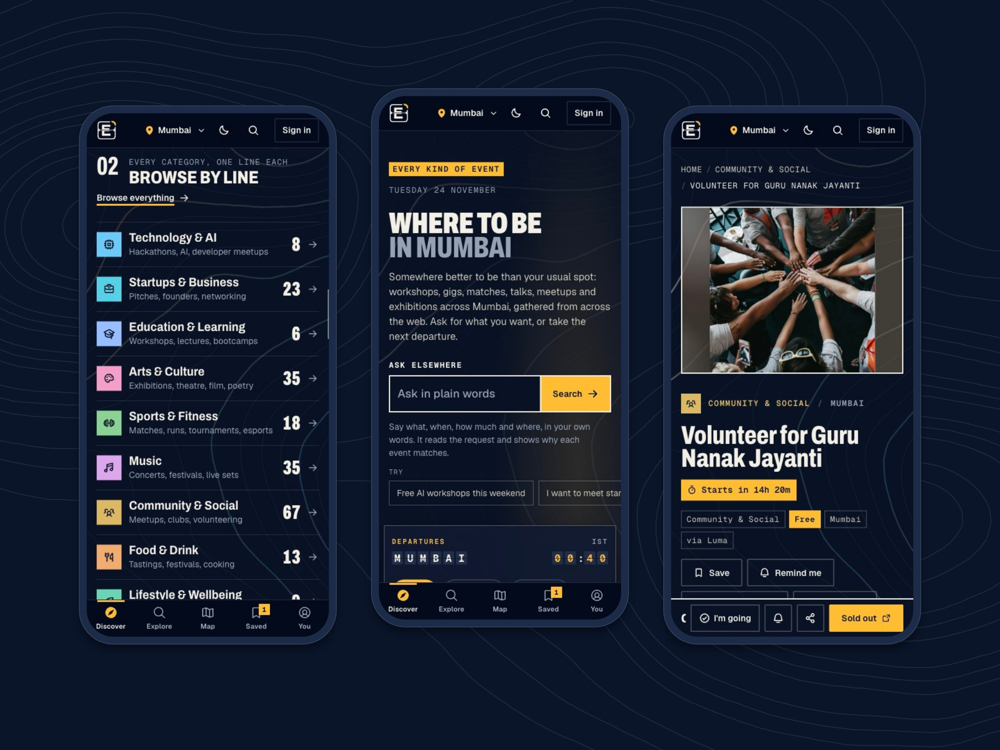
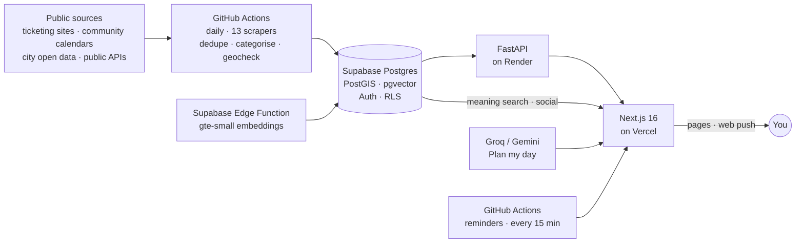

<p align="center">
  <a href="https://elsewhere-in.vercel.app/">
    
  </a>
</p>

<p align="center">
  <b>Every kind of event in your city, in one place.</b><br />
  Hackathons and gigs, workshops and matches, meetups, markets and volunteering drives,<br />
  gathered every day from across the web and searchable in plain words.
</p>

<p align="center">
  <a href="https://elsewhere-in.vercel.app/"></a>
</p>

<p align="center">
  
  
  
  
  
  
</p>

<p align="center">
  <a href="#the-idea">The idea</a> ·
  <a href="#features">Features</a> ·
  <a href="#how-it-works">How it works</a> ·
  <a href="#tech-stack">Stack</a> ·
  <a href="#getting-started">Run it locally</a> ·
  <a href="#project-journey">Journey</a> ·
  <a href="#roadmap">Roadmap</a>
</p>

<br />

<p align="center">
  <picture>
    <source media="(prefers-color-scheme: light)" srcset="docs/readme/home-day.jpg" />
    
  </picture>
</p>

<p align="center"><sub>The home page, in day or night to match your GitHub theme: ask in plain words, or take the next departure.</sub></p>

---

## The idea

Finding something to do is oddly hard. A gig lives on one ticketing site, a hackathon on another, the Sunday run in a WhatsApp group, the free workshop on a community calendar nobody checks. You find out about the best things the day after.

**ELSEWHERE** puts all of it on one board. It reads public listings from ticketing sites, community calendars and city open data every day, sorts them into twelve lines (tech, startups, learning, arts, sports, music, community, food, wellbeing, outdoors, family, nightlife), and lets you ask for what you want the way you'd ask a friend.

The design borrows from a railway station: a **departures board** of what starts next, a **boarding pass** for every event, a **passport** of the places you've been. Discovery should feel like picking a train and going.

> There's always something happening elsewhere. This is where you find it.

---

## Features

Everything below is live on [elsewhere-in.vercel.app](https://elsewhere-in.vercel.app/).

### Ask in plain words

Type *"stand up comedy today under ₹500"*. A parser reads the what, when, budget and place (typos included) and turns them into filters you can see and remove. Alongside it, meaning-based search ranks events by what they're about, so loose requests still land. Every result says **why it matched**.

<p align="center"></p>

### The map

Every event with a location, clustered by area and drawn with its own poster, beside a list of what's on in view. Filter by line, or press **Play today** to watch the day's events light up in order. Venue coordinates are checked against OpenStreetMap so pins land where the venue is.

<p align="center"></p>

### A page for every event

A boarding pass with date, time and price tiers, a live countdown, the full description from the organiser's page, and one-tap actions: save, **Remind me** (a push notification 2 hours before), add to Google or Apple calendar, WhatsApp and share. Signed in, you can mark Going or Interested and add it to a list.

<p align="center"></p>

<details>
<summary><b>And the rest</b></summary>
<br />

| | |
|---|---|
| **Departures board** | Today, tomorrow or the weekend in your city, on split-flap tiles with a live local clock. |
| **Explore** | Every upcoming event with filters for line, mood, date, price, format and distance, sorted by match, time, price or distance. |
| **Plan my day** | Describe the day in English or Hinglish, typed or spoken. An LLM picks two to four real events by ID, then code checks timing, travel and budget and maps the route. A rules planner takes over if the model is unavailable. |
| **55 cities** | 19 Indian cities and 36 around the world, each shown in its own time zone. |
| **Saved and reminders** | Save without an account. Turn on reminders and the site sends web push notifications; it installs as an app on phones. |
| **Alerts** | Save any search as an alert and get new matches on Telegram or by email (double opt-in). |
| **Friends, lists and polls** | Sign in with Google or an email link to follow friends, keep lists and ask friends to vote on where to go. |
| **Passport and recap** | Stamps collected as you save events, and a monthly recap you can share as an image. |
| **Share images** | Every event, poll and recap gets its own preview image, rendered on the server. |
| **Three themes** | Day, night and vivid. By default it follows your device. |

</details>

<br />

<p align="center">
  
</p>
<p align="center"><sub>On a phone: the twelve lines, the home page, an event with its action bar.</sub></p>

---

## How it works



**1. Gather.** Once a day a GitHub Actions job runs each scraper as its own step: District, Insider, AllEvents, Meetup, Luma calendars, Eventbrite, Ticketmaster, SeatGeek, Eventfinda, Paris open data and more. Scrapers read Schema.org JSON-LD, ICS calendars and public APIs, then the pipeline normalises everything into one `events` schema, removes duplicates on `(source, source_id)`, assigns one of twelve categories, fills in descriptions and ticket tiers from each event's own page, and checks venue coordinates against OpenStreetMap. Unchanged rows are not rewritten.

**2. Understand.** Each event is embedded into a 384-dimension vector with gte-small, Supabase's built-in model, in an Edge Function. Embeddings are recomputed only when an event's text changes (an md5 of the embedded text is stored beside it). Search is an exact scan rather than an approximate index on purpose: there are thousands of upcoming events, not millions, and an approximate index would silently drop rows once time and distance filters apply.

**3. Ask.** A request like *"something educational tomorrow"* goes through two paths at once: a parser that pulls out date, time, budget, city, format and words; and a vector search that ranks by meaning. The page shows how it read the request as removable chips, and every result carries its reason.

**4. Plan.** Plan my day shortlists about thirty candidates with cheap scoring, asks a free LLM to choose and explain two to four stops *by ID only*, so it can't invent an event, then re-checks the picks in code: real events, no clashes once travel time is counted, within budget.

**5. Stay up.** Listings are served stale-while-revalidate, so pages keep working when the free-tier database is slow or down. A keep-warm job pings the API every ten minutes, and errors go to Sentry.

---

## Tech stack

| | |
|---|---|
| **Frontend** | Next.js 16 (App Router) · React 19 · TypeScript · plain CSS with OKLCH design tokens (Tailwind 4 for a few utilities) · Motion · MapLibre GL · Three.js · Phosphor Icons · Archivo, Geist and Geist Mono |
| **Backend** | FastAPI · Pydantic · httpx · BeautifulSoup and lxml · icalendar · APScheduler |
| **Database** | Supabase Postgres · PostGIS for distance and map bounds · pgvector for meaning-based search · row level security |
| **Search and AI** | gte-small embeddings in a Supabase Edge Function · Groq or Gemini for Plan my day, with a rules fallback |
| **Auth** | Supabase Auth: Google and email links |
| **Integrations** | Web Push (VAPID) · Telegram bot and Brevo email for alerts · OpenStreetMap geocoding · OpenFreeMap tiles · Sentry |
| **Deployment** | Vercel (web) · Render (API) · Supabase (database, Edge Function) · GitHub Actions (scraping, reminders, keep-warm) |
| **Testing** | Vitest (frontend) · pytest (backend) |

---

## Project structure

```text
.
├── frontend/                   Next.js app (deployed to Vercel)
│   ├── src/
│   │   ├── app/                Routes: home, explore, map, events/[id], plan-my-day,
│   │   │                       saved, passport, recap, alerts, friends, lists, poll…
│   │   │   └── api/            Route handlers: semantic search, plan, reminders,
│   │   │                       alerts, share cards, travel times, recap…
│   │   ├── components/         UI components (departures board, map, event page…)
│   │   ├── lib/                Search parser, planner, caching, push, themes, data access
│   │   └── hooks/
│   ├── public/                 Icons, service worker, background contours
│   └── docs/                   Older design screenshots
├── backend/                    FastAPI service and scrapers (deployed to Render)
│   ├── app/
│   │   ├── api/events.py       /api/events: search, map, counts, by id, ingest
│   │   ├── scrapers/           One module per source
│   │   ├── services/           Ingestion, dedupe, categorisation
│   │   └── enrich/             Detail pages, ticket tiers, images, geocheck
│   ├── run_scrapers.py         CLI used by the daily GitHub Action
│   ├── feeds.json              ICS calendar feeds (Luma, by city)
│   └── tests/                  pytest suite
├── supabase/
│   ├── migrations/             Schema, search functions, social, polls, reminders
│   └── functions/embed/        Edge Function that writes embeddings
├── .github/workflows/          scrape-events · send-reminders · keep-warm
├── docs/                       Setup guides: social, reminders, global sources
└── SCRAPING.md                 Running the scrapers locally
```

---

## Getting started

<details>
<summary><b>Prerequisites</b></summary>
<br />

- Node.js 20.9 or newer (required by Next.js 16)
- Python 3.11
- A [Supabase](https://supabase.com) project (the free plan works)

</details>

**1. Clone**

```bash
git clone https://github.com/KushalDeopurkar/elsewhere.git
cd elsewhere
```

**2. Database.** In the Supabase SQL editor, run the files in `supabase/migrations/` in order (`001` first). Meaning-based search also needs the `embed` Edge Function from `supabase/functions/embed`.

**3. Backend**

```bash
cd backend
python3.11 -m venv .venv && source .venv/bin/activate
pip install -r requirements.txt
cp .env.example .env          # add SUPABASE_URL and SUPABASE_KEY
uvicorn app.main:app --reload --port 8000
```

Fill the database with real listings:

```bash
python run_scrapers.py --source district --city mumbai   # one source, one city
python run_scrapers.py --dry-run                         # scrape without writing
```

**4. Frontend**

```bash
cd frontend
npm install
cp .env.example .env.local    # BACKEND_URL=http://localhost:8000 is the only must
npm run dev                   # http://localhost:3000
```

With no backend running, the dev server falls back to a small set of sample events, labelled as such, so the UI still works.

<details>
<summary><b>Optional features and their keys</b></summary>
<br />

Every key in `frontend/.env.example` is optional except `BACKEND_URL`. A feature whose key is missing switches itself off.

| Feature | Variables | Setup notes |
|---|---|---|
| Accounts, friends, lists, polls | `NEXT_PUBLIC_SUPABASE_URL`, `NEXT_PUBLIC_SUPABASE_ANON_KEY`, `SUPABASE_SERVICE_ROLE_KEY` | [docs/social-setup.md](docs/social-setup.md) |
| Plan my day | `GROQ_API_KEY` or `GEMINI_API_KEY` | Falls back to the rules planner |
| Reminders | `NEXT_PUBLIC_VAPID_PUBLIC_KEY`, `VAPID_PRIVATE_KEY`, `VAPID_SUBJECT` | [docs/reminders.md](docs/reminders.md) |
| Email and Telegram alerts | `BREVO_API_KEY`, `ALERT_EMAIL_FROM`, `TELEGRAM_BOT_TOKEN` | |
| Global sources | `TICKETMASTER_API_KEY`, `SEATGEEK_CLIENT_ID`, `EVENTFINDA_*` in `backend/.env` | [docs/global-sources.md](docs/global-sources.md) |
| Error tracking | `NEXT_PUBLIC_SENTRY_DSN` | |

</details>

**Build and test**

```bash
(cd frontend && npm run build && npm test && npm run lint)
(cd backend && pytest)
```

---

## Project journey

ELSEWHERE began at **VecnaVerse 2026**, a 36-hour national-level hackathon held on 5 and 6 November 2026. Built by **Team Nexora**, it cleared multiple competitive rounds and finished among the **Top 40 teams nationwide**.

The hackathon produced the first version. Work has continued since: the daily scraping pipeline, meaning-based search, Plan my day, reminders, the social layer, caching that kept pages up through a database outage, and a full redesign around the departures board and the split-flap logo.

---

## Roadmap

These are proposals, not shipped features.

- [ ] **Event format in the database.** Online or in person is not a database column yet; storing it would make the format filter exact.
- [ ] **More Indian sources**, with the same dedupe and geocheck as the current ones.
- [ ] **Readable production errors** by uploading source maps to Sentry on each build.
- [ ] **Recommendations from saves and Going**, using the embeddings already stored for every event.
- [ ] **Tighter checks on category and date matching** for listings whose source data is thin.

---

## Contributing

Issues and pull requests are welcome.

1. Fork the repo and create a branch from `main`.
2. Keep changes focused, and run `npm run lint`, `npm test` and `pytest` before opening a PR.
3. Adding a source? Put a scraper in `backend/app/scrapers/` that returns the shared event model, add a test with a saved fixture in `backend/tests/`, and register it in `run_scrapers.py`.

Listings belong to their sources. ELSEWHERE links back to the organiser's page for every event; see [SCRAPING.md](SCRAPING.md) for notes on source terms. A licence file has not been added yet.

---

<p align="center">
  
</p>

<h3 align="center">Don't just wonder what's happening. Find out what's happening elsewhere.</h3>

<p align="center">
  <a href="https://elsewhere-in.vercel.app/"><b>elsewhere-in.vercel.app</b></a> ·
  <a href="https://github.com/KushalDeopurkar/elsewhere">GitHub</a>
</p>

<p align="center"><sub>Built by Team Nexora at VecnaVerse 2026. Maintained by <a href="https://github.com/KushalDeopurkar">Kushal Deopurkar</a>.</sub></p>
