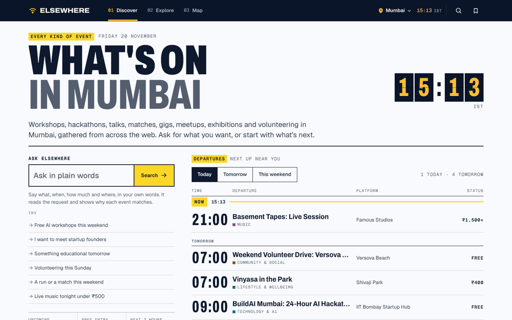
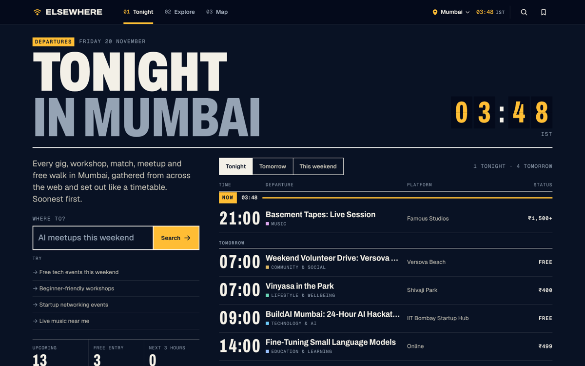
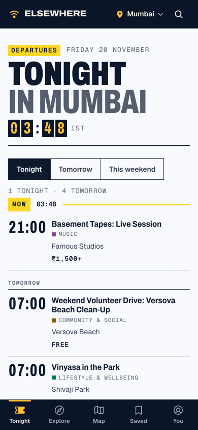
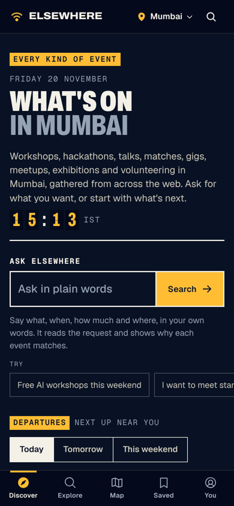
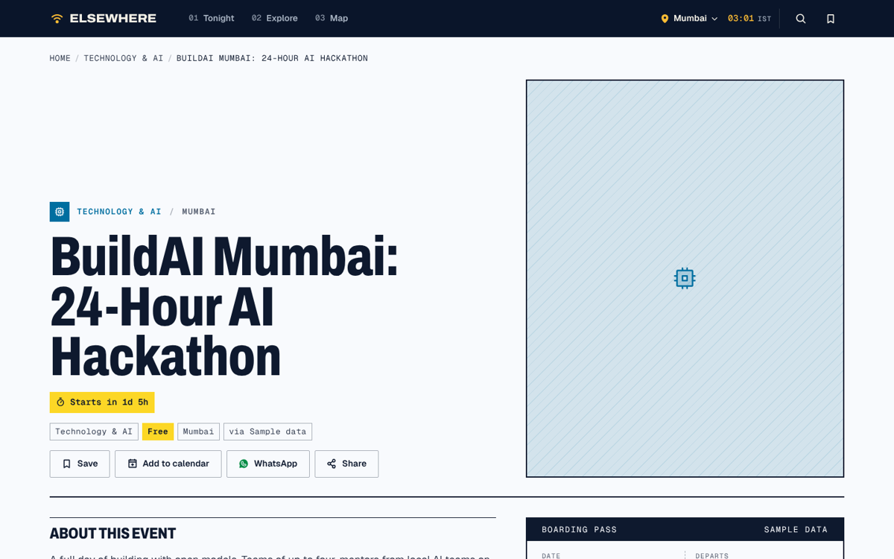
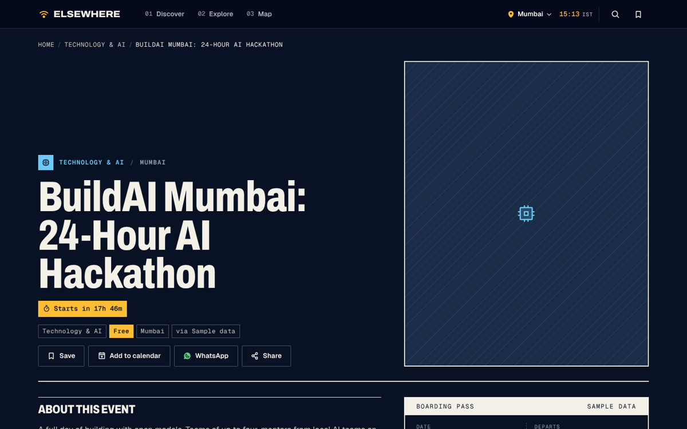

# Elsewhere: the frontend

Everything happening in your city, set out like a timetable you can act on.

<p>
  
  
</p>

<p>
  
  
</p>

Elsewhere gathers gigs, workshops, matches, meetups and free walks from ticketing sites, community calendars and city open data, and shows them soonest first. This folder is the Next.js app; the API and scrapers live in `../backend`.

## What you can do

- **Discover** (`/`): what's on in your city, in every category. Ask Elsewhere in plain words ("I want to meet startup founders", "free AI workshops this weekend"); beside it, the departures board of what's next with a live NOW line. Below: headliners, starting soon, every category as a line, collections by plan (learn something, meet people, get moving), the weekend, free entry.
- **Explore** (`/explore`, `/categories/<slug>`): every listing with filters for category, mood, date, price, format (in person or online) and distance; removable chips for whatever is in force; 24 at a time. A plain-words request shows what it understood and, on each ticket, why the event matches.
- **Map** (`/map`): the city at night. Busy areas cluster into numbered markers in their category colour; pointing at an event in the list lifts its pin; a timeline shows what is on at any hour; travel times and a phone card strip.
- **Keep it**: save events, get reminders, add to your calendar, plan a day around them (`/plan-my-day`), collect passport stamps, replay your month (`/recap`).
- **Go with friends** (with an account): profiles, friends, who's going, lists and "who's free?" polls.

## Design: the city timetable

Every city is a timetable and every event is a departure. The site follows the sun in the chosen city: a printed timetable by day (white paper, blue-black ink, signal yellow), and a lit departure board from 18:00 to 06:00 (deep blue, warm white, amber). The map always runs on the night board. Settings can pin either one.

- Tokens: `src/app/tokens.css` (semantic names, OKLCH, both themes designed). The rules are in [`DESIGN.md`](DESIGN.md).
- Type: Archivo (variable width, condensed for times and headlines), Geist for reading, Geist Mono for codes and labels. All self-hosted through Fontsource.
- Signature: `src/components/Timetable.tsx` (the home hero), with `FlapText` for the split-flap times.
- Theme: `src/lib/theme.ts` sets the theme before first paint; `src/components/ThemeSync.tsx` keeps it current.

<p>
  
  
</p>

## Run it

Needs Node 20 or newer and the backend running (see `../README.md`). Without the backend the app shows a labelled sample timetable.

```bash
npm install
cp .env.example .env.local   # then fill in the values you have
npm run dev                  # http://localhost:3000
```

| Command | What it checks |
|---|---|
| `npx tsc --noEmit` | types |
| `npm run lint` | ESLint (Next.js core web vitals + TypeScript) |
| `npm test` | Vitest unit tests for the pure logic in `src/lib` |
| `npm run build` | production build |

## Stack

Next.js 16 (app router), React 19, Tailwind CSS 4 (as the CSS pipeline; styles are plain CSS on the tokens), Motion, MapLibre GL, Supabase (accounts and social), web-push.

Screenshots above use the bundled sample events with the poster fallback art, so no listing is shown with someone else's image.

## Credits

- Type: [Archivo](https://github.com/Omnibus-Type/Archivo) by Omnibus-Type and [Geist](https://github.com/vercel/geist-font) by Vercel, both under the SIL Open Font License, self-hosted through Fontsource. The static Archivo cuts in `src/app/api/card/fonts/` are instances of the variable font, made for the share images.
- Icons: [Phosphor](https://phosphoricons.com) (MIT).
- Maps: [MapLibre GL JS](https://maplibre.org) (BSD) with OpenStreetMap data.
- Listings come from the public sources named on each event page; Paris listings from Que faire à Paris, Ville de Paris, under the ODbL.
